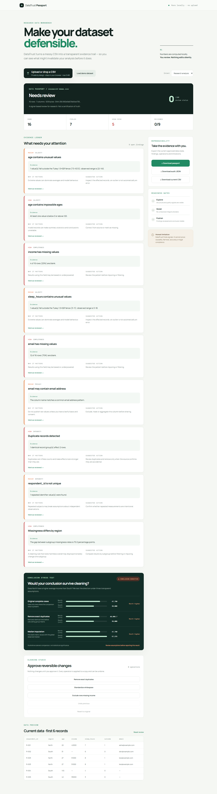

# DataTrust Passport

## Research integrity before the conclusion

DataTrust Passport is a local-first research data workbench that helps a researcher see whether a descriptive result depends on data-cleaning assumptions.

> Upload a CSV, inspect the evidence, stress-test the conclusion, and export a reproducible research passport.



**Local-first · Research integrity · Reproducible evidence**

## The problem

Most data profilers can report missing values, duplicates and outliers. That is useful, but it does not answer the question a researcher is about to face:

> **Would the observed conclusion change under a reasonable cleaning decision?**

DataTrust Passport connects quality evidence to a focused **Conclusion Stress Test**. It compares one group-level numerical result under original complete cases, exact-duplicate removal and median imputation. The calculations are deterministic and descriptive; the app does not claim causality, statistical significance or scientific validity.

## What is implemented

- Local CSV upload and drag-and-drop, with quoted-field and embedded-line-break support
- 5 MB input limit and explicit malformed-row errors
- Dataset dimensions, SHA-256 fingerprint and column summaries
- Missingness, exact duplicates, IQR outlier, invalid-age, subgroup-missingness, small-group, class-imbalance and possible-PII warnings
- Evidence cards with evidence, impact and recommended action
- Reversible Cleaning Studio: duplicate removal, whitespace normalization, missing-income exclusion, undo and reset
- Conclusion Stress Test with real group means, sample counts, scenario medians and direction labels using actual group names
- Markdown Research Passport and structured JSON audit exports
- Current CSV export
- No backend, account, analytics SDK, external API or uploaded-data service

## Verified demo workflow

1. Open the app and choose **Load demo dataset**.
2. Inspect the Evidence Ledger and the synthetic findings.
3. Approve **Remove exact duplicates** in Cleaning Studio.
4. Click **Undo previous** and confirm the operation is removed.
5. Read the Conclusion Stress Test across the three scenarios.
6. Download the current CSV, Markdown passport and JSON audit record.

The bundled dataset is synthetic and deliberately contains duplicate records, missing income, an invalid age, unusual numeric values, possible email PII and a descriptive direction change. It is a demonstration fixture, not evidence about a real population.

## Quick start

### Node static server

The runtime is pinned to Node **22.18.0** in `.nvmrc`, `package.json` and the Dockerfile.

```bash
npm test
npm run serve:node
```

Open <http://localhost:4173/>. The Node server also serves the project-path form at <http://localhost:4173/omnirush/> for GitHub Pages-style path verification.

The Python alternative remains available when Python 3 is installed:

```bash
npm run serve
```

## Docker reproducibility

The image uses `node:22.18.0-alpine`. `npm test` runs during image construction, so a successful build includes the dependency-free automated test suite. The runtime has no external API or network requirement.

```bash
docker build -t datatrust-passport:0.2.0 .
docker run --rm -p 4173:4173 datatrust-passport:0.2.0
```

Then open <http://localhost:4173/>. To run the test command in a development checkout without network access:

```bash
npm test
```

This repository contains no runtime npm dependencies. Docker verification was not executed in the release environment because Docker was unavailable there; the Dockerfile is intentionally small and the build step explicitly runs the test suite.

## Architecture

- `index.html` — dependency-free browser shell with project-relative assets for `/omnirush/` hosting.
- `src/analysis.js` — pure CSV parser, deterministic audit checks, cleaning operations, conclusion stress test and report builders.
- `src/app.js` — UI state, upload/drop workflow, evidence review, cleaning approval and downloads.
- `server.mjs` — dependency-free Node static server with root and `/omnirush/` path support.
- `src/styles.css`, `src/stress.css`, `src/audit.css` — responsive visual system.
- `test/analysis.test.js` — Node built-in regression tests with synthetic fixtures.
- `docs/datatrust-passport-demo.png` — screenshot captured from the running application after loading the real bundled demo dataset.

The original file remains in browser memory. SHA-256 is computed locally with Web Crypto. Rendered dataset values are HTML-escaped, and CSV exports quote delimiters, quotes and line breaks.

## Reproducibility and honest limits

The Review Status score is a transparent heuristic: 100 minus 16 points per high-risk finding and 7 points per other finding, floored at zero. It is not a probability, confidence score or scientific quality certification.

The Conclusion Stress Test is a sensitivity signal, not a statistical test. DataTrust Passport does not prove data quality, causality, fairness, privacy compliance or publication readiness. Outlier, PII and imputation checks are heuristics and require domain review.

## Testing evidence

The release test command is:

```bash
npm test
```

The verified release suite contains 12 passing tests covering CSV parsing, malformed rows, duplicate headers, missing values, duplicates, regression means and labels, independent scenario inputs, median handling, equal means, conclusion sensitivity, cleaning operations, CSV round-tripping and JSON audit structure.

The release browser smoke test also verified the real local workflow: demo loading, Evidence Ledger visibility, duplicate removal, undo, Conclusion Stress Test visibility and CSV/Markdown/JSON downloads. The screenshot above is the captured output of that run.

## Deployment and demo links

- Live demo: not deployed
- Demo video: not recorded

No unverified URL is listed here. The static application is suitable for GitHub Pages because its assets are project-relative; deployment still requires enabling Pages on the repository and verifying the public URL.

## Prior work and acknowledgements

DataTrust Passport builds on established ideas rather than claiming scientific originality: [OpenRefine](https://docs.openrefine.org/) for data transformation, [YData Profiling](https://docs.profiling.ydata.ai/latest/) for profiling, [Evidently](https://docs.evidentlyai.com/) for data evaluation and drift, and [Great Expectations](https://greatexpectations.io/) for explicit expectations.

## Built with OmniRush

This project was designed, implemented and verified in OmniRush. No external generative AI tool was used for the build.
